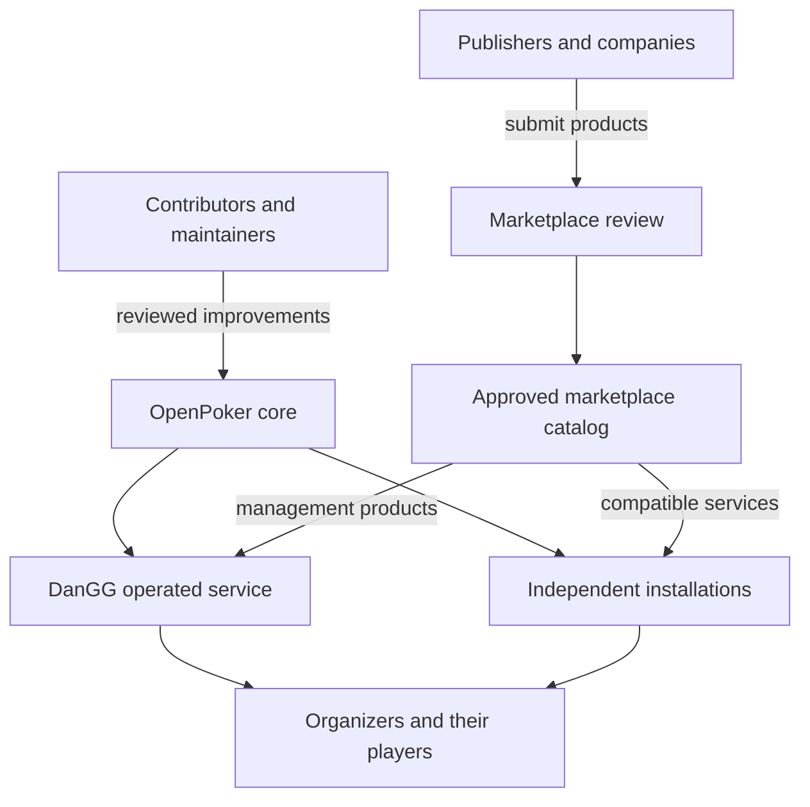
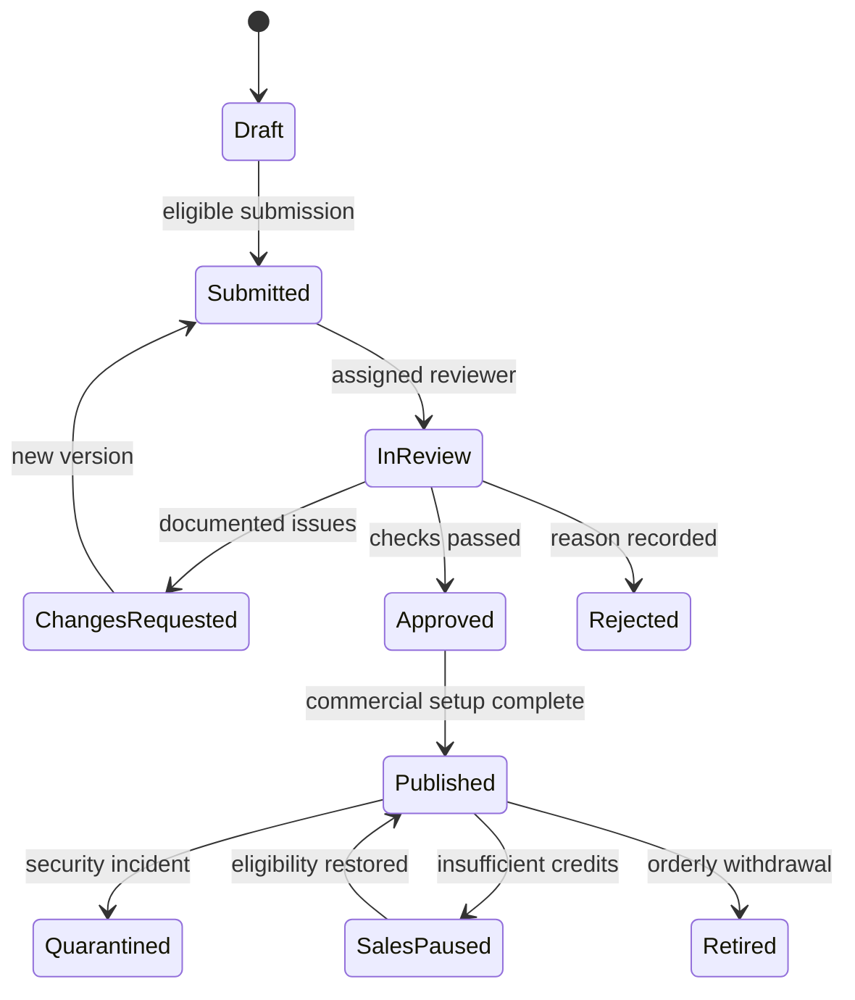
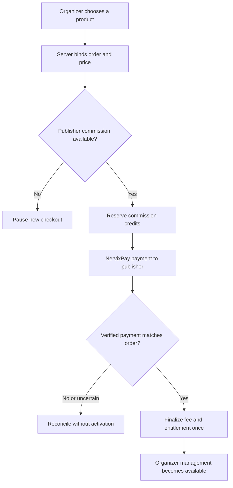

# OpenPoker Marketplace Implementation Plan

**Product and engineering specification**  
**Prepared for Dan Semenescu and OpenPoker contributors**  
**16 November 2026**

## 1 Purpose and outcome

OpenPoker will provide an open-source poker foundation and a marketplace through which organizers obtain paid management capabilities, integrations and services. DanGG.live is the first operated service using that foundation. The first commercial products will package the capabilities already present in the application: cash-table management, tournament management and the supported variants around them. Jackpot Sit & Go, ordinary Sit & Go, fast-fold poker, engagement tools and other products must be listed according to their actual readiness.

The commercial customer is the organizer who wants to create, configure and operate an experience. Players do not need to buy an organizer plugin merely to participate in a game that an authorized organizer provides. Marketplace payments buy software services or management access. They do not buy the application's play chips, tickets or gems, and they do not turn the existing application into a real-money gambling service.

The marketplace operator will publish the first products and admit products from independent developers, studios and established companies. Approved publishers receive customer payments directly through NervixPay. The marketplace earns a 20% commission on eligible publisher receipts, funded by the publisher's prepaid commission balance. The system must connect every commercial order to the correct publisher, buyer, product, payment, commission entry and entitlement.

This document defines the product, commercial rules, implementation boundaries, data model, controls, operating procedures and delivery sequence. It deliberately distinguishes the verified baseline, the initial implementation and the later ecosystem. A catalog listing, an approved request, a manual access grant and a verified paid order are different facts. None may be presented as proof of the others.

### 1.1 Release objective

The initial release establishes a trustworthy management entitlement boundary around existing organizer functions. It supplies a product registry, clear catalog status, operator controls and focused tests. It must preserve ownership checks and the private administrator boundary. Payment automation and publisher self-service must use the same commercial model when introduced, without replacing it with a second incompatible billing system.

An organizer without the required active entitlement should receive a clear explanation and a link to the relevant product when attempting a covered management action. An organizer with access should continue through the existing flow. Purchasing a product must never change `users.is_admin` or grant access to another organizer's resources.

### 1.2 Scope vocabulary

| Term | Meaning in this specification |
| --- | --- |
| Core | The open-source OpenPoker code and its documented public contracts |
| Service | An operated deployment, initially DanGG.live |
| Marketplace | Catalog, publication review, commercial ordering, commission accounting and access management |
| Plugin | A product exposing a defined capability; initially this can be a built-in capability adapter rather than downloaded third-party code |
| Publisher | The individual or organization commercially responsible for a listed product |
| Contributor | Someone contributing code, documentation, design or review to the open-source project |
| Organizer | A customer who manages games, events or a community using authorized resources |
| Entitlement | A server-verifiable grant of a specific capability within a defined scope and time period |
| Commission credit | A prepaid accounting balance used to pay marketplace fees; separate from gameplay balances |
| Platform administrator | A trusted operator with existing private administrative access |

## 2 Verified baseline

The source baseline inspected for this specification is `OpenPoker4all/OpenPoker` at commit `2b0d25ed6ddf1f8dd7885d83d97588371d30ad31`. The project originated as `DansiDanutz/GGPoker-Flash`, then moved to its current OpenPoker location. The separate repository named `DansiDanutz/DanGG` is not the source selected for this implementation. Current code facts in this section refer to that baseline, not an assertion that any subsequent branch has reached production. [1]

The application uses a React and TypeScript client, a Node.js server, SQLite persistence and WebSockets for live games. Marketplace persistence already exists in the same application database. The deployed service is play-money software; familiar currency-style labels in historical game fields do not make those balances cash or a commercial payment ledger. [1][2]

### 2.1 Existing marketplace

The baseline has a public catalog at `/marketplace` and an owner console at `/marketplace/admin`. It supports products, expressions of interest, operator responses and manually provisioned access with optional expiration. It does not provide automated checkout, subscriptions, payment reconciliation, plugin installation or automatic feature activation. The public response explicitly exposes `checkout_enabled: false`. [2]

The four initial offers are club hosting, organizer tools, club branding and community extensions. They begin as coming-soon offers with quotation pricing. Operators can edit them, publish an available offer, respond to a request and grant or revoke access. Approving a request does not collect a payment or grant access automatically.

Existing marketplace tables are `marketplace_products`, `marketplace_settings`, `marketplace_requests` and `marketplace_entitlements`. The latter binds a product to a user account. This is useful for the first entitlement boundary, but it is not a complete organization, team and installation model.

### 2.2 Existing organizer ownership

The application already contains user-scoped hosting routes. A signed-in account can list and create private tables and private tournaments; stored `owner_id` values identify their owner. Delete and moderation routes check ownership. These routes are the most direct place to introduce paid organizer capabilities without giving customers platform administrator rights. [3]

The baseline limits an account to eight private tables and eight private tournaments. Table hosting allows Hold'em, four-, five- and six-card Omaha, Short Deck and an optional bomb pot configuration. Private tournaments support standard, bounty, mystery, satellite and flip modes with NLH, PLO and Short Deck formats. These controls must remain constrained by the underlying game implementation.

Global administration is a different surface. Its existing private-network and administrator checks protect accounts, all tables, all tournaments, operational recovery, balances, moderation and settings. A marketplace purchase must not weaken that boundary. Paid capabilities add a commercial condition where appropriate; they do not replace authorization.

### 2.3 Implementation status language

Every release note, product page and administration view should use the following distinctions consistently.

| Status | Required evidence |
| --- | --- |
| Available | The advertised functionality is implemented, operable and supported for the advertised scope |
| Coming soon | The product direction is public, but checkout or fulfillment is not open |
| Approved | A specific submission or version passed the relevant review; this alone does not prove payment or activation |
| Active access | An entitlement is currently valid for the account or workspace and capability |
| Paid | A trusted payment reconciliation process recorded the required payment against the exact order |
| Verified manually | An authorized operator recorded an access decision and its reason; it must not masquerade as an automated gateway result |
| Deployed | The service reports the intended immutable commit and the required health checks pass |

The implementation appendix at the end of this document is the release-specific record. The following architecture sections also cover later phases; a design described here is not automatically a shipped feature.

## 3 The ecosystem and ownership

OpenPoker's value grows when contributors improve a common foundation and publishers can build sustainable businesses around it. DanGG's marketplace earns its position by making discovery, integration, billing, support and updates dependable. It should not rely on confusing users about their rights to the open-source code.

The project has authors and maintainers. Open source does not mean nobody owns the copyrights. Authors retain their rights, while the software license grants specified freedoms to recipients. Contribution does not automatically give a contributor equity in the marketplace operator, entitlement to a share of every product or authority to approve commercial listings. [4]

The marketplace operator's legal identity, contracting terms and invoice details must be configured before commercial launch. This plan does not invent a company name, tax registration, payment account or gambling license. First-party products are owned and supported by the appropriate rights holder and sold through the same auditable system used for outside publishers.

OpenPoker technical approval and marketplace admission are related but distinct decisions. A useful product does not need to be merged into the core merely to be sold. A core pull request does not become an approved commercial product automatically. Review records must say which decision was made, for which version and by whom.

### 3.1 Governance rules

Core maintainers decide whether code belongs in the shared project. Marketplace reviewers decide whether a product meets publication and operational requirements. Security reviewers can quarantine a vulnerable version. The platform operator controls commercial terms and customer support policy. Publishers control their own product within the agreed contracts and technical permissions.

First-party listings should meet the same published quality requirements as third-party listings. Review priority, promotion and ranking should be documented separately from approval. A publisher's prepaid balance funds fees; it does not purchase a favorable security review or guarantee admission.

A marketplace commission is business revenue. Any allocation to OpenPoker maintenance, infrastructure, audits or contributor bounties is a separate budget decision. Do not promise that every contributor is paid automatically simply because the platform earns a commission.

## 4 Licensing and commercial boundaries

The repository's current combined code uses `AGPL-3.0-only`, subject to the retained historical MIT rights and third-party notices documented in `docs/LICENSING.md`. The historical MIT baseline remains under its original terms. The marketplace cannot revoke rights already granted to those copies. [4]

Commercial hosting and paid services are compatible with the project's open-source model. When the applicable AGPL conditions require source to be offered, the offered source must correspond to the covered version actually used. Charging for hosted management access does not remove that obligation. A private deployment repository is not a substitute for a required source offer. [4][5]

This leads to a precise product promise: the official service can require a paid entitlement to use its hosted management capabilities. An independent operator can exercise the rights available under the software's license and modify their own deployment, subject to that license. The marketplace's commercial controls are not a promise that nobody can copy or change open-source code.

Calling software a plugin does not determine its license obligations. The actual relationship between components matters. A label such as commercial module, an approval badge or a network boundary does not by itself establish permission to combine proprietary software with the core. Before distributing an integration, document its license, dependencies, interfaces and rights to redistribute its assets. [4][6]

DCO sign-off certifies the contributor's right to submit the contribution under the project's process. It is not a copyright assignment and does not automatically provide proprietary relicensing rights from every contributor. A separate proprietary licensing strategy requires a rights analysis rather than a catalog checkbox. [4][7]

The core, marketplace brand, provider brands and publisher brands have separate identities. Product names and visuals must accurately describe affiliation. Existing artwork or reverse-engineering notes do not establish permission to redistribute third-party proprietary assets. Plugin submission must include an asset and dependency provenance declaration.

### 4.1 What organizers pay for

An offer must state the service purchased: a hosted management capability, maintenance, support, a compatible external service, installation assistance or a separately licensed product where the necessary rights exist. It must state whether access is time-limited, which resource scope it covers, what happens when the term ends and whether updates are included.

A one-time purchase of a hosted capability needs a clear service duration and support policy; the phrase lifetime access is too ambiguous without defining whose lifetime and what service is promised. A downloadable open-source package and a hosted subscription can have different terms. The customer should see those terms before payment.

## 5 Existing feature inventory

The inventory distinguishes game availability from organizer controls. A playable game is not automatically a ready-to-sell management product. Product approval requires both working functionality and a supported operational surface. [3][8][9]

| Feature family | Verified application state | Organizer product direction |
| --- | --- | --- |
| Cash Hold'em | Existing tables, gameplay and private hosting | Cash Games Manager |
| Omaha | Four-, five- and six-card variants exist in engine or seeded tables; host flow supports all three | Include supported variants in Cash Games Manager, with consistent validation |
| Short Deck | Existing table and tournament format | Include supported management in the appropriate cash or tournament product |
| Bomb pots | Private table creation exposes a bomb-pot option | Cash product capability, preserving engine limits |
| Scheduled tournaments | Existing creation, registration, multi-table rooms and persistence | Tournament Manager |
| Bounty and mystery | Existing tournament modes | Tournament package or clearly priced add-on capabilities |
| Satellites | Existing ticket-oriented tournament mode | Tournament package; tickets remain play-money application objects |
| Flip tournaments | Existing `FLIP` mode | Tournament package where current implementation supports it |
| Jackpot Sit & Go | Existing `spingold` engine and lobby, three seats, configured 5,000 and 10,000 play-chip entries | The initial change adds private hosting through Spin & Go Manager |
| Ordinary Sit & Go | No separate verified general-purpose auto-start SNG product in the inspected baseline | Planned product; do not sell a tournament title as proof of this engine |
| Fast Fold | Existing `rush` and `rushplo` pools, lobby and cash-drop configuration | Fast Fold Manager with pool-level controls and isolation |
| All-in or Fold | Existing `aof` table mode | Separate management capability or explicit cash package inclusion |
| Quick Flip | Existing game key and related interface paths | Verify end-to-end operational behavior before declaring a standalone product available |
| Battle Royale | Explicitly disabled and rejected by current validation | Unavailable; not eligible for paid activation |
| Slots | Existing simulated slots catalog and play-money game routes | Future scoped casino management product; not a live supplier integration |
| Casino table games | Simulated blackjack, roulette, baccarat, Dragon Tiger and Sic Bo interfaces and routes | Future management adapters for supported simulated games |
| Crash | Existing simulated play-money experience | Future operational controls and reporting product |
| Missions and rewards | Existing mission, daily and reward administration | Community Engagement Manager after organizer scoping |
| Branding and banners | Existing global administration | Club Branding once settings are scoped to a community or installation |
| Reports and history | Existing game, user and transaction views | Organizer analytics after ownership filtering and export policy |

The inspected admin table validator omits `omaha6` while the host flow and seeds include it. This is a consistency issue to resolve before promising equivalent variant configuration across every management surface. The catalog should be generated from a deliberate supported-capability registry rather than treating every historical game string as a supported product.

### 5.1 Jackpot SNG constraints

The current Jackpot SNG implementation is specific. Its configured stakes, seat count, outcome distribution and blind behavior come from the versioned game code. A management plugin must not silently expose unrestricted changes to payout probabilities or advertise verified behavior for arbitrary stakes. Price configuration for the management service is separate from play-chip entry configuration. [8]

The product can initially control supported table creation, enablement, schedule and operational visibility without claiming an unrestricted game-design editor. Any later custom mathematical model needs independent versioning, tests and review. Existing events should retain the rules with which they started.

### 5.2 Ordinary Sit & Go acceptance requirements

A genuine ordinary Sit & Go product requires a queue or registration threshold, a defined number of seats, an automatic start condition, starting stacks, a blind structure, prize allocation and cancellation/refund behavior. It needs concurrency protection so the same seat is not sold twice and the event does not start twice. Reconnect and restart recovery must preserve entries and the event state.

These requirements must be fulfilled before the product becomes available. Until then it can be visible as coming soon with a clear description. A scheduled tournament can reuse parts of the engine, but relabeling it Sit & Go without implementing the start and lifecycle contract would mislead organizers.

## 6 Product packaging and prices

The first catalog should use recognizable organizer outcomes rather than a long list of internal engine switches. Cash Games Manager and Tournament Manager use existing hosting flows. This change adds private Jackpot SNG hosting as a third management product. Fast Fold follows once scoped pool controls are ready. A bundle may contain several capabilities, but each capability must still have a stable identity for access decisions.

| Product family | Initial commercial scope | Price configuration |
| --- | --- | --- |
| Cash Games Manager | Create and configure supported private cash tables | Operator-defined; no invented production price |
| Tournament Manager | Create and configure supported private scheduled tournaments | Operator-defined; no invented production price |
| Sit & Go Manager | Auto-start non-jackpot events when implemented | Coming soon until fulfillment exists |
| Spin & Go Manager | Private hosting of the supported three-player Jackpot SNG format | Operator-defined; initial adapter included in this change |
| Fast Fold Manager | Configure and operate authorized pools | Coming soon until pool ownership is enforceable |
| Community tools | Branding, reports, engagement and integrations with scoped data | Publish separately when each advertised feature is deliverable |

The platform may support fixed-price purchases, monthly or annual subscriptions, usage fees and hybrid contracts. The initial release should favor simple fixed or recurring prices because they are easier to explain, reconcile and support. Different pricing models must not change the ownership and entitlement rules.

A published offer stores a price revision. The server snapshots that revision on the order so a publisher cannot change the price, currency, commission rate or promised term after the buyer begins payment. Discounts and taxes must have explicit fields and rules. A formatted string such as $100 is display copy, not an authoritative amount.

No default price in this document is a market valuation or an approved live tariff. The $100 examples illustrate accounting. Before enabling a product's checkout, the operator sets its actual price, duration, support terms and tax treatment.

### 6.1 Version and bundle rules

An entitlement should identify capabilities and the permitted product version range. A bug-fix update within a compatible range can be offered under the same term. A breaking major upgrade should have an explicit migration and commercial policy. Customers should never discover that an update removed paid functionality because a bundle definition changed retroactively.

A bundle records the included capabilities at purchase time. A later bundle edit applies to new orders unless an explicit customer-favorable upgrade is made. Avoid overlapping products that require buyers to pay twice for the same capability without clear added value.

## 7 Roles and authorization

Commercial access and resource authorization are independent conditions. Every management request must first identify the user and resource, then verify that the user is allowed to manage that resource, and finally evaluate the applicable entitlement. Client-side hiding is only a usability feature; the server makes the access decision.

| Role | Allowed responsibility | Does payment grant this role? |
| --- | --- | --- |
| Player | Join permitted games and use player features | No organizer purchase required solely to play |
| Organizer | Manage owned resources within active capabilities | A purchase supplies access, not ownership of unrelated resources |
| Organizer team member | Perform delegated actions in a future workspace model | Requires explicit membership and role assignment |
| Publisher | Submit and support owned products, inspect own sales | Requires publisher onboarding, not platform administrator status |
| Reviewer | Review assigned submissions and versions | Assigned by the platform operator |
| Finance operator | Reconcile exceptions and documented adjustments | Assigned separately from commercial purchase |
| Platform administrator | Operate and recover the service through private controls | Never granted by purchasing a plugin |

The first implementation can use the existing account and `owner_id` model. It must describe that scope accurately. A full multi-organization service requires explicit organizations, memberships, resource ownership, invoice identity and installation bindings. Reusing a global admin panel as an organizer workspace would expose unrelated customers' data and controls.

### 7.1 Essential safety access

Some actions should remain possible after commercial management access expires: inspecting one's existing resources, exporting appropriate owned data, reporting an issue, completing already-started activity and safely closing an empty resource. Moderation needed to stop immediate abuse should not depend on a fresh checkout.

This is a product rule rather than an entitlement bypass. The capability registry should classify actions as new commercial management, continuity, safety or read-only. Tests must cover the classification so an overly broad exemption cannot create new paid resources for free.

## 8 Entitlements and continuity

An entitlement answers a specific question: may this account or workspace perform this capability on this resource now? It should contain a product or capability reference, subject, scope, effective start, optional expiry, source and status. The source distinguishes a verified commercial order, an operator grant, a migration allowance or a documented service remedy.

An entitlement is effective only when its status is active, its start has arrived and its expiry has not passed. Expiry must be calculated server-side in UTC. A stale browser tab or cached catalog cannot prolong access. Revocation is a recorded transition with an actor and reason, not deletion of the purchase history.

New purchases and renewals must not overwrite historical terms. An order can extend access from the later of the existing paid end date and the new term's start, according to the product's renewal rules. The system should avoid wasting a customer's remaining days when they renew early.

### 8.1 Publisher balance and customer access

The recommended commercial policy is to pause new sales and unfunded renewals when a publisher cannot fund the commission for the next order. Existing paid access continues for its paid term. This separates a seller's financing problem from a customer's already fulfilled payment obligation.

The reason is mathematical. If a publisher has exactly $20 of available credits and completes a $100 sale, the agreed commission consumes those $20. A global disable-at-zero rule would immediately switch off the product for the customer who just paid. It could also interrupt every other organizer using that publisher's products.

The proposal to disable all organizer use when the publisher balance reaches zero should therefore not be implemented as a hidden consequence of a normal sale. If a later contract introduces a separate operating reserve, it needs a distinct balance, advance notice, a grace period and buyer protection. The commission reserve remains attached to orders already authorized.

This document adopts continued service for already-paid entitlements as the recommended implementation policy. It does not describe a previous explicit agreement to revoke that customer protection. Any decision to change it is a material commercial policy change and must be communicated before customers buy.

### 8.2 Running games

An entitlement check belongs at management boundaries, such as creating a new event or changing future configuration. It should not run in the betting loop to terminate a hand because a billing service is unreachable. Existing tournaments and already-started Jackpot SNG sessions must be able to settle according to their recorded rules.

When organizer access expires, new management activity can be blocked while ongoing games finish. Data, hand history, event results and audit records remain available under the appropriate retention and ownership policy. A critical security incident can require a separate controlled shutdown, but a billing pause must not be mislabeled as a security emergency.

## 9 Publisher onboarding and review

A publisher starts by creating a publisher profile linked to a normal account or, later, an organization. Individuals and companies follow the same technical process, with legal identity and tax information appropriate to the contracting party. Free open-source contributors do not need to become sellers or fund credits merely to contribute code.

The publisher connects an authorized NervixPay merchant identity and receiving configuration. The platform verifies that the connection belongs to the publisher through a supported provider flow. A typed wallet address or screenshot is not sufficient proof of control. Credentials stay on the server and are scoped to the necessary operations.

The publisher may save an unpublished product before topping up. Submitting it for commercial review requires the configured minimum available credit balance and completed account requirements. This is an eligibility threshold, not an automatic review charge. If a submission fee is introduced later, it needs an explicit price, receipt and refund policy.

### 9.1 Submission package

The submission includes product name, plain-language purpose, capabilities, supported OpenPoker versions, distribution form, license, source and asset provenance, requested permissions, data handling, installation method, operational requirements, documentation, support contact, price models and cancellation terms.

For executable integrations it also includes a versioned manifest, reproducible package reference or immutable artifact digest, dependency inventory, test evidence, migration behavior and rollback instructions. External services declare endpoints, timeout behavior and what happens if the supplier is unavailable. Reviewers must be able to reproduce the advertised feature in an isolated environment.

### 9.2 Review state model

Approval applies to a product version and permission set. A later update that requests new access or changes game behavior must be reviewed according to its risk. Cosmetic copy changes can use a lighter process, but they must not be used to hide a change in the service being sold.

Publishers receive specific reasons for changes or rejection and a clear resubmission path. Reviewers record conflicts of interest. Marketplace staff can moderate misleading claims and unsupported affiliation independently of the technical review.

## 10 Order and payment journey

The organizer opens an available offer, selects a price and scope, sees the term and support policy, and begins checkout. The server creates an immutable order snapshot. Before creating a payment instruction, it reserves the publisher's required marketplace commission in one database transaction.

The organizer pays through NervixPay. The full eligible sale amount goes to the publisher's receiving destination. The platform later consumes the commission reservation from the publisher's prepaid credit balance after verifying payment. This is not an on-chain 80/20 split of the customer's transaction.

The successful payment screen is informative. It is not the authority that grants access. A forged browser message, changed query string or copied transaction hash must not unlock a product. The server verifies the signed provider notification or retrieves the payment through a trusted provider API, then matches the recorded order binding.

The order binding includes seller, buyer, product, price revision, currency, amount, network, token, receiving destination where applicable, capability scope and provider payment identifier. Customer-supplied reference text is not a substitute for that binding.

### 10.1 Essential order states

An order begins created, becomes awaiting payment after its reservation and provider instruction are established, and reaches paid only after verification. It can become expired, cancelled or payment exception without pretending that a payment disappeared. Refunds and disputes are separate recorded transitions linked to the original paid order.

The platform must handle a provider request that succeeds while the local HTTP response is lost. A stable idempotency key and a stored provider reference allow a retry to find the same payment instruction. If creation fails conclusively, the commission hold can be released. If the result is unknown, reconciliation determines the outcome before the order is recreated.

Every paid order has exactly one commission capture and the intended entitlement effect. Retrying the webhook, refreshing the success page or rerunning reconciliation must return the previously recorded result. Duplicate notifications are normal operating conditions, not exceptional circumstances.

## 11 Commission economics

The standard marketplace commission is 20% of the eligible publisher receipt attached to a marketplace order. The publisher receives the customer payment directly, while the marketplace earns its fee by consuming previously funded commission credits. The distinction between payment movement and economic share must be visible in publisher statements.

| Example item | Amount | Explanation |
| --- | --- | --- |
| Organizer purchase | $100 | Illustrative price for the service |
| Payment to publisher | $100 | Gross payment directed to the publisher |
| Marketplace commission | $20 | Consumed from the publisher's prepaid credits |
| Publisher economic proceeds | $80 | Before provider fees, taxes and the publisher's operating costs |

For an eligible receipt `R` and commission rate `c`, the marketplace fee is `R × c`. With the standard rate, `c = 0.20`. Publisher proceeds before other costs are `R − (R × c)`. These formulas describe the fee policy; they do not imply that the payment processor splits the transfer.

Suppose a publisher starts with $100 of commission credits and sells five $100 subscriptions. The publisher receives $500 in customer payments, $100 of credits is consumed, and the publisher's economic proceeds are $400 before other costs. The next $100 order cannot be opened until at least $20 is available for its commission reservation. The five existing buyers retain the terms they purchased.

The remaining sale capacity is related to available commission funds, not the number of installed plugins. With $80 of unreserved credits, a 20% commission rate supports up to $400 of eligible new receipts. A publisher with several products shares the same balance only if the account terms and ledger explicitly define that shared scope.

### 11.1 Define the eligible amount

The commercial agreement must state whether the commission base excludes taxes, discounts, refunds and pass-through charges. A suitable initial policy is to calculate commission on the service price after discounts, excluding separately collected taxes, before payment-provider fees. This is a proposed commercial rule to configure and disclose, not a claim about a tax determination.

The order stores the exact base and resulting fee. A later change to the standard commission rate must apply prospectively to new price or contract revisions. Historical paid orders retain their agreed rate unless a separately authorized adjustment is recorded.

NervixPay's own processing economics remain separate. A marketplace fee must not be implemented by changing a provider-wide rate or applying 20% to every unrelated payment a publisher receives. Only orders bound to this marketplace contract are eligible. The publisher dashboard can show both costs, but each line should identify its source and basis.

### 11.2 Credit top-ups and revenue

A top-up increases the publisher's available commission balance. It does not mean that the platform has already earned a commission on a sale. The ledger must distinguish money received to fund credits, commissions earned from completed orders and any unused balance remaining. The finance team should agree the legal and accounting treatment with its accountant before issuing live invoices.

An invoice or statement must not charge the same commission twice. If the fee was already settled from prepaid credits, the document should show the charge and the application of prepaid funds. The purchase receipt to the organizer and the marketplace fee document to the publisher represent different relationships and may have different issuers.

## 12 Ledger and reservation design

The commission ledger must use integers for money. Floating-point arithmetic can produce inconsistent fees and balances, especially across repeated adjustments. The implementation should choose a documented unit, such as USD cents or USD micros, and keep conversion at explicit boundaries. External token amounts require their own integer base units and decimals.

For the first commercial release, USD-only orders are simpler than silently treating a euro or leu price as an equivalent dollar amount. Foreign-currency quotation offers can remain in the catalog. If multi-currency checkout is introduced, the order must retain a trusted exchange-rate quote, timestamp, source, rounding policy and the resulting commission amount in the ledger's currency.

The balance model has three concepts: posted credit balance, active reservations and available credits. Available credits equal posted balance minus outstanding reservations. Capturing a reservation reduces the posted balance and removes the corresponding hold in the same transaction. It must not reduce available funds a second time.

### 12.1 Atomic checkout reservation

Two buyers may start checkout at the same moment. If the publisher has $20 available, both requests must not independently approve a $20 reservation. The reservation check and insertion must execute within the database's atomic write boundary. In SQLite, an immediate transaction is appropriate for this local serialization pattern.

The operation loads the publisher's eligible status, reads or derives available funds, checks the order's immutable fee, inserts the order and reservation, and commits. If any validation fails, no order that can receive a payment instruction should remain without its intended reservation. Order identifiers and idempotency keys need uniqueness constraints.

After a trusted payment is matched, one atomic operation records payment evidence, captures the fee, marks the order paid and creates or extends the entitlement. If the server crashes before commit, a retry can perform the operation. If it crashes after commit but before responding, a retry reads the existing result.

### 12.2 Journal requirements

The accounting record should be append-only. Ordinary operations do not edit or delete a historic credit entry to make a balance look correct. Corrections reference the original entry and explain why a compensating entry was added. Each entry has a stable ID, publisher, amount, currency or unit, event type, reference, actor or system source and timestamp.

At minimum, the lifecycle distinguishes top-up, reservation, reservation release, commission capture, commission reversal and authorized adjustment. Reservations may be stored separately from posted monetary entries, but the reconciliation report must show both. A cached balance is acceptable only when it is updated atomically and can be checked against the journal.

No commission operation may use `users.balance`, play chips, tickets, gems or the game transaction tables as its funding source. A field that historically displays USD inside the play-money application remains a gameplay field. The marketplace needs a separate commercial accounting domain.

### 12.3 Expiry and late payment

An unpaid order has a defined expiry and a reservation-release policy. Releasing a hold does not guarantee the customer cannot later send a blockchain payment to a previously shown address. The system needs a late-payment state and a deterministic reconciliation path.

A safe late-payment policy checks whether the order can still be fulfilled and whether its fee can be reserved again. If either condition fails, it records a payment exception for support and refund handling rather than granting unsupported access or silently consuming another buyer's reserved credits. The customer sees that payment was detected and that resolution is pending.

The payment provider's finality rule must be explicit for each supported network. A transaction identifier alone does not prove final settlement, the correct token, amount or recipient. The platform records the provider's verified payment result and retains enough non-secret evidence to reconcile it.

## 13 Refunds, reversals and disputes

The organizer's refund and the publisher's commission reversal are linked but distinct events. Because the customer pays the publisher directly, the marketplace cannot assume it holds those funds or can refund them without a supported provider operation or publisher action. The policy must identify who authorizes, executes and verifies the refund.

A full verified refund can reverse the eligible commission and revoke or end the access derived solely from that order according to the contract. It must not erase unrelated access bought through another order. A duplicate refund notification must not create a second credit. The ledger keeps both the original capture and its reversal.

Partial refunds require a proportional or otherwise contractually specified fee adjustment, cumulative limits and a defined effect on entitlements. If the first implementation supports only full refunds, its UI and API must reject partial refund claims rather than approximate them. Supporting partial accounting is a later capability with its own acceptance tests.

A dispute state may freeze new sales or flag an account without destroying existing evidence. The platform should collect the offer revision, accepted terms, payment proof, fulfillment timestamp, relevant support correspondence and version installed. Sensitive customer information belongs in access-controlled support records, not public transaction explorers.

### 13.1 Failure examples

| Situation | Required behavior |
| --- | --- |
| Payment succeeds but webhook is delayed | Reconcile through the provider; show pending confirmation; do not ask the buyer to pay again automatically |
| Webhook is delivered repeatedly | Return the existing settlement result with no duplicate fee or access extension |
| Payment amount is insufficient | Keep a payment exception or provider partial-payment state; no full entitlement |
| Payment uses the wrong token or network | Match against the original order and follow a documented recovery policy |
| Publisher withdraws a product during checkout | Honor an already bound fulfillable order or resolve/refund explicitly |
| Publisher balance reaches zero after capture | Pause new unfunded orders; preserve already paid access |
| Refund is recorded twice | One commission reversal and one entitlement adjustment |
| Buyer account is banned | Security access rules can block use independently of payment history; billing history remains intact |

## 14 NervixPay integration contract

NervixPay is the required payment route for commercial marketplace sales. This requirement applies to sellers using the marketplace, not to every developer contributing to OpenPoker. The marketplace needs a supported platform integration, not a collection of manually copied payment links whose ownership cannot be verified.

Before enabling live checkout, the adapter must demonstrate merchant authorization, server-side payment creation, payment lookup, authenticated notifications, supported amount and currency semantics, idempotency behavior, refunds or an explicit manual refund workflow, and operational error handling. Credentials must be scoped, encrypted at rest where stored, rotated and excluded from browser bundles, logs, source archives and documents.

The provider adapter should expose a narrow internal interface. Typical operations are create a payment for an already reserved order, retrieve its trusted status, validate an incoming notification and normalize evidence for settlement. Business rules for the 20% commission and entitlements stay in the marketplace domain, so provider response formats do not become the access policy.

### 14.1 Notification validation

The server verifies the provider's signature using the exact raw request body and the documented timestamp scheme. It enforces the replay window, validates the expected merchant and matches the provider payment identifier to the marketplace order. It uses constant-time signature comparison where appropriate and limits request size before expensive processing.

After cryptographic validation, the payload still requires business validation. A signed notification may describe a real payment that belongs to another merchant or an unrelated purchase. Settlement requires the correct order, seller, amount, currency or token, network and final status. A publisher-supplied product name, referrer or customer reference does not authorize a grant.

If a merchant's integration permits only one notification endpoint, marketplace onboarding must not overwrite an existing business integration silently. The supported design needs provider-side event subscriptions or a documented fan-out service that preserves existing delivery. This is an integration acceptance requirement before onboarding external sellers.

### 14.2 Browser behavior

The browser starts an order through the marketplace server and follows the returned payment destination. It polls a server-owned order status or receives a trusted application event after settlement. A client success callback may prompt a refresh, but cannot write a paid state or create an entitlement.

The UI should explain pending, confirmed, expired and exception states in ordinary language. It should display the exact purchase, recipient identity and supported payment assets. It should not tell the customer to repeat payment solely because one network request timed out.

### 14.3 Payment observability

The discussion referred to NervixScan; the currently inspected payment ecosystem includes PayScan-style transaction visibility. Explorer or receipt links are useful evidence for support and reconciliation. They do not establish plugin ownership, an organizer entitlement or a game's revenue base by themselves.

A public payment view should not expose publisher credit balances, account credentials, private customer details or internal review notes. Marketplace staff need a separate authorized reconciliation view that joins payment evidence with commercial orders and ledger entries.

## 15 Data architecture

The initial implementation should extend the existing marketplace with additive migrations. Existing catalog edits, expressions of interest and manual access records must survive the upgrade. New seeds use stable identifiers and insert missing records without overwriting an operator's price, copy or publication decision.

The long-term domain has the following entities. Exact physical table names belong to the release-specific implementation appendix; this model defines responsibilities rather than asserting that every table already exists.

| Entity | Responsibility and important links |
| --- | --- |
| Product | Public identity, publisher, capabilities, publication state and delivery form |
| Product version | Immutable artifact, compatibility range, permissions and review outcome |
| Offer or price revision | Amount, currency, term, commission basis, tax presentation and accepted terms |
| Publisher | Legal seller identity, eligibility, payment connection and support responsibility |
| Submission | Version proposed for review with evidence and reviewer decisions |
| Order | Immutable buyer, seller, product, price and scope snapshot |
| Payment binding | Provider payment identifier and expected settlement attributes |
| Commission reservation | Funds held for a specific order until capture or release |
| Credit journal | Posted funding, earned fees, reversals and audited adjustments |
| Entitlement | Effective capability grant derived from payment or another explicit source |
| Installation | Deployment identity and permitted capability scope for future independent installations |
| Organization and membership | Future team ownership and delegated permissions |
| Audit event | Actor, action, subject, timestamp and bounded evidence |

Foreign keys and uniqueness constraints should enforce relationships wherever practical. A paid order must reference one valid publisher and buyer; a provider payment cannot settle two independent orders; a commission capture cannot occur twice for the same order. Application checks complement these constraints but should not be their only implementation.

### 15.1 Data separation

Marketplace commercial data should be logically separated from game state even while both live in one SQLite database. Backup procedures include both, but recovery must not replay a monetary capture merely because a game snapshot was restored. External payment truth may be newer than a restored local database.

A restored system therefore begins with reconciliation before accepting new live orders. It compares provider payment records and the local order journal, replays missing events idempotently and reports mismatches. The game server's existing snapshot mechanism is not a complete financial disaster-recovery procedure.

### 15.2 Data access

Publishers can read their products, orders, commission usage and customer information necessary to fulfill the contract. They cannot query another publisher's balance or all player activity. Organizers can read their own orders and entitlements. Reviewers can see submission evidence without automatically receiving finance privileges.

Exports must obey the same ownership filter as the interactive screen. Download links should expire and be authorized; exported spreadsheets should not contain raw secrets or unnecessary personal data. Retention periods belong to the operating policy and applicable legal requirements, with an implementation for deletion or anonymization where appropriate.

## 16 Built-in capability boundary

The initial plugin implementation does not need to download and execute arbitrary third-party code. It can register built-in management capabilities around trusted code already in the application. This gives the business model a usable first product while keeping the eventual extension boundary deliberate.

The registry should hold a stable capability key, product identity, display name, supported management surface, readiness and classification. Route handlers should reference these keys rather than infer payment requirements from a translated title or mutable category label. The product catalog may change its marketing name without changing which server action is protected.

Every covered mutation follows the same sequence: authenticate, parse and validate the request, load the actual existing resource when one is referenced, verify resource authority, determine the required capability, evaluate access, perform the mutation and record the relevant audit event. Invalid requests should not become successful paid actions merely because the customer holds a broad entitlement.

### 16.1 Existing route coverage

| Surface | Baseline role | Commercial boundary |
| --- | --- | --- |
| `POST /api/tables/host` | Signed-in owner creating a private table | Require the capability for the chosen supported game family |
| `GET /api/tables/host` | Owner inspecting private tables | Preserve read access and show management eligibility separately |
| `DELETE /api/tables/host/:id` | Owner closing an empty table | Preserve ownership and safe-cleanup checks |
| Private table mute routes | Owner moderating an owned table | Preserve safety moderation independently of a new sale |
| `POST /api/tournaments/host` | Owner creating a private tournament | Require Tournament Manager |
| `GET /api/tournaments/host` | Owner inspecting events | Preserve read access |
| `DELETE /api/tournaments/host/:id` | Owner deleting a not-started private event | Preserve lifecycle and ownership checks |
| Admin table create or configuration | Existing private administrator | Require configured management access when enforcement applies |
| Admin table duplication | Existing private administrator | Evaluate the actual source and resulting game capability |
| Admin tournament create or configuration | Existing private administrator | Require configured tournament access when enforcement applies |
| Live game actions | Authorized player or existing game process | Do not introduce payment checks into hand settlement |
| Backup, recovery and snapshots | Private operator | Remain available for safe service operation |

A request that changes an existing object's game family must be evaluated against its actual stored state and the requested destination. A table ID supplied by a client is not proof of ownership. Duplicate routes need their own coverage because they can create a resource without calling the ordinary creation endpoint.

WebSocket management messages also require the boundary. An HTTP guard is incomplete if a host can change the same protected setting over an authenticated socket. Conversely, ordinary player actions such as betting, leaving and reconnecting should continue under game authorization rules.

### 16.2 Enforcement modes

The initial rollout uses explicit enforcement configuration. Off preserves existing behavior while the commercial data and catalog are prepared. Observe records or reports eligibility decisions without blocking existing operations. Enforce blocks covered new management actions when the required access is absent.

The mode must be controlled by deployment configuration, shown in the private console and returned where the UI needs it. A public query parameter or local storage value cannot change server enforcement. Changing the mode does not activate a payment connector or make unpriced products purchasable.

Keeping the initial default off avoids silently locking out existing organizers on software upgrade. The production activation runbook makes the transition concrete: configure products, reconcile intended access, test denied and allowed users, announce the terms, then change the deployment configuration deliberately.

## 17 Organizer experience

The organizer should understand what is included before clicking Create. The hosting interface can show the active management product, its end date and a plain-language explanation if access is missing. It should link directly to the relevant marketplace product rather than send the customer to an unrelated admin section.

When access is inactive, preserve the organizer's view of existing tables and events. Clearly distinguish a management restriction from a game failure. For example, “Cash Games Manager is required to create another private table” is more useful than “Forbidden” or “Payment error.” The response should identify the required product without leaking internal account data.

The marketplace account view separates interest requests, paid orders and current access. A previous request can remain approved while a subscription expires; those are compatible historical facts. An unpaid order should not appear as an active subscription. A manual service grant should retain its true source.

### 17.1 Configuration boundaries

An entitled organizer can configure only the fields the product and engine actually support. Game fairness, outcome distributions, cross-customer data and platform credentials are not ordinary organizer settings. Financial product configuration and play-chip game configuration should appear in distinct panels with unmistakable labels.

For private Jackpot SNG hosting, the interface should expose only the supported fixed stakes and derive the seat count and related constraints from the server-supported rules. It should not accept a custom six-seat jackpot game simply because the cash-table form has a seat dropdown.

### 17.2 Renewals and ending access

Before an entitlement expires, the organizer should see a renewal date and a clear renewal action if checkout is available. If the product is temporarily unavailable for new sales, the screen should explain support options without suggesting that a completed payment will fix an unavailable service automatically.

When a subscription ends, the server blocks new covered management actions. The product's terms define how existing resources wind down, what data remains available and whether an already running event can finish. These terms should be part of the order snapshot and remain accessible after expiry.

## 18 Publisher experience

The publisher dashboard should answer four practical questions: which products are approved, which can receive new sales, how much commission funding is available, and what was earned and charged for each order. It should not require the publisher to reconstruct their business from raw blockchain transfers.

Display posted balance, reserved credits and available credits separately. Show the next-order fee requirement and an estimate of sale capacity for the product being viewed. A low-balance notification can be based on a fixed threshold, expected sales or the largest enabled order, but it must not promise a sale capacity that ignores active reservations.

The dashboard presents gross customer receipts, marketplace fees, refunds, provider fees when known and economic proceeds as distinct lines. It should label estimates and exclude pending payments from confirmed receipts. A revenue chart should not count publisher top-ups as customer sales.

### 18.1 Automatic restoration

After a confirmed top-up, a publisher's sales eligibility can be reevaluated automatically. Restoration still requires an approved product, valid merchant connection and enough available commission funds for the actual order. A top-up cannot remove a security quarantine or replace a missing compatibility review.

Competition can reward reliable publishers through customer choice and discovery. A paused listing may lose opportunities for new orders, but existing buyers are not silently transferred to a competing plugin. Migration requires compatible data, the organizer's decision and a clear commercial offer.

### 18.2 Company publishers

The data model should support a business with multiple team members and products. Only authorized finance members should change receiving details or reconcile payments; developers may upload versions without payout authority. Sensitive merchant changes should be verified, audited and made visible to the publisher's owner.

Enterprise contracts may include support commitments, volume discounts, dedicated integrations or negotiated royalty terms. These variations should become explicit price or contract revisions while using the same order, entitlement and ledger invariants. Special handling must not bypass the accounting history.

## 19 Platform administration

The existing owner console remains the place to configure products, review requests and inspect operational status. The new commercial controls should be organized around publisher, product, order, payment evidence, credit balance and entitlement, with links between related records. Internal notes stay private.

An operator should be able to answer why a management action was denied. The diagnostic view should show the evaluated capability, enforcement mode, user or workspace scope, entitlement source and effective dates. It should distinguish no purchase, expired access, revoked access, insufficient role and a product that is not implemented.

Manual payment verification is a controlled recovery or pilot process. The operator records the actual provider identifier, expected order and evidence before marking it verified. The interface must not label this an automatic NervixPay integration. Tests and logs should preserve who made the decision and when.

### 19.1 Commission adjustments

Funding and adjustment controls require bounded amounts, a reason and a unique reference. A double click or retried request must not credit an account twice. An operator adjustment is not evidence that funds arrived through the provider. Reports distinguish verified top-ups from explicit manual adjustments.

A monetary correction should be a compensating entry. Revoking an entitlement should not silently refund the customer. Refunding an order should not silently remove unrelated access. Operators need separate actions with precise consequences instead of a generic delete button.

### 19.2 Owner recovery

The platform owner must retain access to finance, support and recovery controls when their own management product is inactive. This does not imply an automatic free entitlement for game management in enforce mode. It means that a missing commercial grant cannot prevent the owner from reconciling payment, granting the correct access or repairing configuration through already authorized private controls.

No default production password should be added to the marketplace. Existing account recovery and private network access remain subject to the service's established procedures. The implementation must not copy any credentials from chat history into code, tests, examples or documentation.

## 20 Third-party extension architecture

The later marketplace needs a documented plugin SDK and a narrow permission model. Publishers should integrate through stable APIs for allowed actions and events rather than importing arbitrary server internals. The SDK can provide compatibility checks, manifests, test fixtures, migration hooks and examples.

A manifest declares the plugin ID, version, supported core range, license, capabilities supplied, permissions requested, dependencies, configuration schema, data migration version and operational entry points. Immutable package hashes bind review to the artifact actually installed. A mutable download URL is insufficient as the only identity of an approved version.

### 20.1 Isolation

Untrusted publisher code should not execute inside the main game process with direct database or filesystem access. A reviewed extension architecture can use separate processes or services with scoped credentials, bounded resources, timeouts and explicit network permissions. The choice must account for latency and game integrity rather than assume that a JavaScript sandbox provides complete isolation.

An extension should request narrow permissions such as reading an owned event summary or creating an authorized report. It should not receive all user records, private cards, game RNG state, platform signing keys or unrestricted SQL. Permissions are versioned, visible to organizers and reviewed when expanded.

### 20.2 Updates and migration

Updates progress through validation, approval, staged rollout and production activation. Organizers should know whether an update is automatic, optional or required to fix a critical vulnerability. The system needs a known-compatible rollback version and a data migration strategy that does not destroy customer records.

A plugin can retire, lose support or be quarantined. The platform should preserve its historical orders and provide export or migration routes where the contract allows. Replacing a plugin requires compatibility and an explicit organizer choice; marketplace competition alone does not migrate data safely.

### 20.3 Independent installations

The official marketplace may offer commercial services to independent OpenPoker deployments. A future installation identity can bind signed entitlements to a deployment, domain or organization and permit bounded offline verification. The design should tolerate temporary marketplace outages without interrupting active games.

That mechanism controls access to the commercial service or supplied artifact under its terms. It does not make an AGPL installation impossible to modify. The economic value must come from trustworthy distribution, hosted services, maintenance, integrations and support rather than a promise that open-source users cannot change their own code.

## 21 Security and abuse resistance

The marketplace adds commercial consequences to an application that already manages live game state. Its first security priority is preserving the existing authentication, resource ownership and private administration boundaries. Paid status is not a replacement for any of those controls.

Server mutations use bounded allowlists and parameterized queries. Account status is checked where relevant. Catalog descriptions remain text unless a deliberate sanitization policy permits markup. Product identifiers and publisher references are validated, and public responses use explicit projections so internal notes and merchant configuration do not leak accidentally.

Protection against cross-site requests follows the application's authentication model. Cookie-based mutations need appropriate origin and request protections; bearer tokens must not be exposed in URLs or persistent public content. Rate limits apply to expensive or financially significant endpoints, and login protections remain independent of marketplace access.

### 21.1 Threat model

| Threat | Required control |
| --- | --- |
| Customer forges a payment success message | Only trusted server verification can settle an order |
| Publisher spends one credit balance concurrently | Atomic reservations and ledger invariants |
| Buyer purchases one product and creates another game type | Stable capability mapping based on validated server state |
| Customer changes an unrelated organizer's resource | Ownership and future workspace membership checks |
| Repeated webhook or operator request charges twice | Unique payment, order, funding and refund references |
| Publisher changes the recipient after checkout | Immutable merchant and payment binding |
| Third-party update gains hidden privileges | Version review and explicit permission changes |
| Restored backup forgets a paid order | Provider reconciliation and idempotent replay before new sales |
| Missing subscription disables recovery tools | Separate safety and finance administration from paid management |
| Malicious plugin reads every account | Process or service isolation and scoped APIs |

The first release should not expand payment-capable endpoints to public callers merely because the internal commerce service exists. Internal functions that accept verified payment evidence trust their caller. Every HTTP adapter must provide the missing authentication and verification boundary explicitly.

## 22 Future game revenue royalties

A publisher can offer a product with a fixed setup charge plus a contractual royalty on the organizer's attributable game revenue. That commercial arrangement needs a defined revenue base, reporting source, settlement period and audit rights. It is a later scope beyond the present play-money management products.

The platform's 20% commission applies to the eligible amount the publisher actually earns and collects through the marketplace contract. It is not automatically 20% of every wager or 20% of the organizer's entire business profit. If the creator earns a 15% royalty and the marketplace takes 20% of that royalty, the platform's effective share is 3% of the agreed royalty base.

### 22.1 Worked example

All figures below are illustrative assumptions, not a forecast or a claim about typical supplier rates.

| Monthly item | Amount | Calculation |
| --- | --- | --- |
| Settled stakes | $1,000,000 | Assumed activity for the particular game |
| Settled payouts | $970,000 | Assumed player payouts |
| Gross gaming revenue | $30,000 | Stakes minus payouts |
| Agreed deductions | $6,000 | Only deductions specified in the contract |
| Royalty base | $24,000 | Gross revenue minus agreed deductions |
| Publisher royalty at 15% | $3,600 | 15% of the royalty base |
| Marketplace fee at 20% | $720 | 20% of the collected publisher royalty |
| Publisher proceeds | $2,880 | Royalty minus marketplace fee, before other costs |
| Organizer amount after royalty | $20,400 | Royalty base minus publisher royalty, before other costs |

If the same product also has a $1,000 setup fee, the marketplace commission on that separate receipt is $200. The example's first-period marketplace fees total $920 only if both the setup fee and the royalty are eligible and collected. A reported royalty that the organizer has not paid is not a confirmed publisher receipt.

### 22.2 Revenue versus profit

Gross gaming revenue is not the organizer's final profit. A contract using net gaming revenue must list permitted deductions. A true profit-share contract also needs rules for operating costs, allocation of shared costs, timing and audit. Otherwise two parties can calculate very different amounts from the same game activity.

For example, if a $24,000 revenue base has $18,000 of agreed operating costs, the pre-royalty profit base is $6,000. A 15% publisher share is then $900, the marketplace fee is $180 and the organizer retains $5,100 before any remaining obligations. This differs substantially from a 15% royalty on revenue.

A negative carryforward rule changes future invoices. If one period has a minus $10,000 eligible base and the next has plus $24,000, a contract carrying the loss forward produces a $14,000 billable base. A 15% royalty is $2,100 and the platform fee on its collection is $420. The contract must say whether this rule applies and at what product, operator and period scope.

### 22.3 Metering and collection

The authoritative activity record is a settled round and wallet ledger with event identifiers, reversals and reconciliation. Deposits and withdrawals alone do not measure gaming revenue. A payment explorer can prove that an invoice payment occurred; it cannot establish the underlying revenue base without game accounting.

Variable royalties need a period close, signed or verifiable usage statement, dispute window, invoice, payment match and commission capture. The fee is not fully known at the start of a month. A commercial reserve or periodic credit requirement can fund expected fees, but it does not guarantee that the organizer pays the publisher's royalty invoice.

## 23 Real-money and live supplier boundary

The current application and first management products remain play-money. A live dealer blackjack integration or a real-money slot supplier is a separate project involving different technical, contractual and jurisdictional requirements. Installing a plugin or paying a software subscription does not establish authority to offer real-money gambling.

For Romania, the consolidated gambling framework addresses both operators and connected software, hosting and payment activities. Supplier obligations and restrictions concerning unlicensed operators require a jurisdiction-specific assessment before a real-money launch. The implementation must not assume that calling the platform open source or using cryptocurrency removes those obligations. [10]

The UK Gambling Commission similarly distinguishes gambling software supply from arrangements that host gambling facilities through other operators. A software license and a host operating arrangement have different implications. This illustrates why the exact service relationship matters; it is not a conclusion that one jurisdiction's license permits worldwide operation. [11]

The later implementation should have an explicit legal and technical release gate for each target market and supplier. Its technical work includes verified operator eligibility, game certification where applicable, accurate wallet settlement, audit trails, incident handling and responsible service controls. No existing play-money ledger should be reclassified as real customer funds through a configuration switch.

## 24 Metrics and operating evidence

The marketplace needs metrics that explain whether it is providing value and whether its accounting is correct. The first reporting set should distinguish approved publishers, available products, active paid organizers, fulfilled orders, gross eligible receipts, captured commissions, refunded commissions and outstanding credit liabilities.

A product's installations, active users and sales are separate quantities. One organizer may have several staff members and many players. Counting every player session as a sold plugin seat would misstate adoption. The pricing model must define the billable unit before a usage meter is used to invoice customers.

### 24.1 Operational indicators

Track unmatched payments, payment-review orders, reservations approaching expiry, notification failures, reconciliation lag, unauthorized management attempts and entitlement decision latency. Track publisher balance runway and sales pauses without exposing those private balances publicly.

For reliability, monitor game completion, recovery snapshots and plugin-related errors independently of commercial metrics. A plugin that sells well but causes failed tournaments is not a successful product. Review response time, support response time, refund rate and upgrade failures help identify where the marketplace is losing trust.

Metrics must be traceable to events and orders. A dashboard total should be reproducible from the journal rather than an editable counter. Financial reports should disclose their date range, currency, gross or net definition and treatment of pending or refunded orders.

## 25 Test and acceptance strategy

Tests should focus on the boundaries that can create unauthorized access, lost payments or interrupted games. Pure UI snapshots are insufficient for these risks. Use temporary databases, fixed clocks and deterministic payment evidence for commerce tests; never send test money through a production merchant by accident.

| Area | Required acceptance evidence |
| --- | --- |
| Catalog migration | New seeds preserve existing operator edits and legacy products |
| Product readiness | Planned products cannot be published as available through a mutation shortcut |
| Authorization | A paid customer cannot enter private admin or manage another owner's resources |
| Management enforcement | Missing, expired and refunded access block covered mutations in enforce mode |
| Observe mode | Eligibility is visible without changing the underlying action result |
| Safety and continuity | Reads, safe cleanup, moderation and ongoing gameplay remain usable as specified |
| Game-family mapping | Cash, tournament and jackpot access cannot be substituted by changing request fields |
| Credit contention | Two orders cannot reserve the same remaining funds |
| Payment binding | Wrong merchant, network, token, amount or provider reference cannot settle |
| Idempotency | Repeated funding, payment and refund evidence has one accounting effect |
| Expiry and late payment | Released orders enter review without silently charging or unlocking |
| Renewal | Calendar boundaries and early renewal preserve the intended term |
| Refund isolation | Refunding one order does not revoke another order's purchased access |
| Ledger integrity | Corrections are additive and posted balance cannot consume reserved funds |
| Provider integration | Sandbox end-to-end tests demonstrate actual provider creation, verification and recovery |
| Browser flow | Organizer and owner screens work at mobile and desktop widths with clear errors |

The provider integration row is a launch requirement, not evidence that the initial internal ledger implementation has completed live payment integration. The release-specific record should list the commands actually run and their outcomes separately from this full acceptance plan.

### 25.1 Useful adversarial cases

Exercise a buyer attempting to submit their own paid evidence, an organizer changing a foreign table ID, an admin duplicating a protected table through an alternate route, and a WebSocket management mutation that bypasses the browser's disabled button. Test that a legacy manual service grant does not satisfy the paid management policy.

Exercise a $100 sale against exactly $20 of credits, then confirm that the buyer has access at a publisher balance of zero. Refund it once and retry the refund. Test two paid orders for the same capability and refund only one. These cases validate the commercial promise directly.

## 26 Deployment and activation

Development belongs in a feature branch based on a verified current main commit. Review should include code, tests, migration behavior and the source-offer implications of the deployed version. The existing deployment script expects a committed, CI-green main revision; a new feature branch is not automatically deployed to DanGG.live. [12]

The proposed product workflow is to develop and verify service improvements, then contribute appropriate general improvements to OpenPoker through review. A separate product branch and staging deployment are architectural options, not existing capabilities merely because they were discussed. The actual deployment configuration should remain the authority.

### 26.1 Initial rollout sequence

1. Back up the application database and record the current deployed commit.
2. Deploy the reviewed code with marketplace enforcement off.
3. Confirm the additive schema migration and preservation of existing catalog and account data.
4. Configure the first-party publisher, product readiness, USD prices and terms through the authorized operator workflow.
5. In an isolated environment, reconcile a complete purchase and test both allowed and denied organizer actions.
6. Use observe mode to identify affected existing organizers and resource creation paths.
7. Resolve access for intended organizers through verified purchases or an explicitly supported commercial policy; do not label fabricated receipts as payments.
8. Publish clear organizer terms and support guidance before enforcement changes.
9. Enable enforce mode deliberately and verify the deployed environment value and health commit.
10. Monitor denied actions, payment exceptions, new orders and game continuity, with a documented rollback path.

Enforcement activation and automated checkout activation are separate decisions. The first can be exercised with a controlled verified-payment pilot, while the second requires the actual provider adapter and end-to-end verification. Neither is implied by a green unit-test suite alone.

### 26.2 Rollback

The fastest commercial-policy rollback is to restore the previous enforcement mode through deployment configuration while retaining the ledger and access evidence. Do not delete paid orders or reverse fees solely to undo a UI release. If code rollback is required, verify that the older application can coexist with the additive schema and that no new commercial payments will be accepted without reconciliation.

For a database restore, stop new commercial order creation, preserve the newer payment evidence, restore the intended backup and reconcile external payments before resuming. Financial recovery must account for payments that occurred after the backup. Running games follow their existing recovery procedures independently.

## 27 Operating runbooks

### 27.1 Organizer reports that a paid plugin is locked

Confirm the signed-in account, exact product and resource. Inspect the order's payment state, its paid access interval and the active enforcement mode. Check whether the action requires a different capability or a separate resource role. If the payment is awaiting confirmation, use trusted provider evidence and reconciliation rather than issuing a second charge.

If access is valid but the route denies it, record the request and capability decision and repair the mapping or cache. If the order is refunded or the term expired, explain that precise state and show the appropriate renewal or support path. Do not grant global administrator access as a shortcut.

### 27.2 Publisher reports unavailable sales

Check publication status, publisher approval, merchant connection, supported price type and currency, then compare available credits with the exact next-order fee. Distinguish reserved funds from available funds. Check for stale reservations and use the authorized expiry or release operation.

If a top-up was made, match it through the approved funding process and its unique reference. A public explorer screenshot alone must not become an unverified credit entry. Once funding is confirmed, reevaluate sales eligibility without modifying existing customer terms.

### 27.3 Payment arrives after expiry

Locate the stored provider binding and compare all expected attributes. Record the payment in review. Determine whether fulfillment and commission funding can be reconciled under the supported workflow; otherwise arrange a verified refund with the responsible seller. Do not reuse another customer's order or erase the late payment to make the dashboard appear clean.

### 27.4 Plugin is withdrawn or compromised

Distinguish commercial retirement from a security incident. For retirement, stop new sales, honor the applicable paid terms, communicate a migration path and preserve exports. For a serious vulnerability, quarantine the affected version, assess safe continuity and deploy a reviewed fix or rollback. Preserve incident evidence and explain customer remedies separately from the technical action.

## 28 Delivery roadmap

| Phase | Deliverable | Exit condition |
| --- | --- | --- |
| 1 | Built-in management catalog, entitlement policy, commission ledger foundations and private operator pilot | Covered actions enforced correctly; accounting and ownership tests pass |
| 2 | Production NervixPay adapter and customer checkout | Sandbox and controlled live reconciliation prove the complete payment journey |
| 3 | Publisher self-service, submission review and credit-funded admission | Publishers can submit, receive reasons, top up and track their own orders without global admin access |
| 4 | Organizer organizations and team roles | All owned resources, reports, settings and billing are isolated by workspace |
| 5 | Ordinary Sit & Go, Fast Fold and other management adapters | Each product has a complete supported lifecycle and acceptance evidence |
| 6 | Versioned plugin SDK, isolation and independent installation support | Third-party artifacts can be installed, upgraded and rolled back safely |
| 7 | Advanced metering and contractual royalties | Auditable usage, period close, collection and fee capture reconcile correctly |
| 8 | Any real-money or live supplier expansion | Separate legal, supplier, wallet and operational release gates are satisfied |

Phase order can overlap where dependencies permit, but later product labels should not imply that their exit conditions are already met. A reliable two-product marketplace with repeat customers is a better evidence base for expansion than dozens of available labels with no operational contract behind them.

The immediate business validation should measure whether organizers pay for Cash Games Manager, Tournament Manager and the supported Jackpot SNG management experience, whether they can use those products without support intervention, and whether publishers can reconcile every receipt and fee. Those observations determine the next investment in pricing, publisher tooling and game adapters.

## 29 Initial implementation reference

This section describes the implementation prepared with this specification. It is a code-change record, not a declaration that the branch has been merged or deployed. The pull request and deployed health commit remain the evidence for those later steps.

### 29.1 Product registry and access policy

`app/server/management-plugins.js` defines five stable built-in product IDs. `cash-games-manager`, `tournaments-manager` and `spin-and-go-manager` have implemented management adapters. `sit-and-go-manager` and `social-casino-manager` remain planned, and product validation refuses to mark them available. The original four catalog products remain intact.

The new implemented entries are seeded as available with quotation pricing and no numeric tariff. That means their management functionality exists, while a fixed-price commercial order still requires an operator to configure an eligible USD price and publisher binding. The catalog continues to report that automated checkout is disabled.

`GGPOKER_MARKETPLACE_ENFORCEMENT` accepts `off`, `observe` or `enforce`, with `off` as the default. Invalid values cause configuration failure instead of silently selecting a weaker policy. Missing access in observe mode is audited. In enforce mode a covered action returns HTTP 402 with the stable code `paid_plugin_required`, the required product ID and a marketplace link.

The gate checks paid access through the commerce service. Legacy manually granted `marketplace_entitlements` do not satisfy this new paid management condition. There is no implicit administrator bypass for covered game management, and purchasing access does not set an administrator role. The existing private operator console remains available for finance and recovery.

Private table creation now supports the existing `spingold` engine through Spin & Go Manager. The server requires an integer stake of 5,000 or 10,000 play chips, derives three seats and the engine's opening blinds, and rejects bomb pots. Cash and spin products map to their respective management rules. Scheduled private event creation uses Tournaments Manager.

**Lifecycle limit.** This version gates management actions, including relevant creation, configuration, duplication and host setting changes. It does not stop player joins, automatic dealing or further Jackpot SNG cycles on an already created table when the organizer's paid term ends. Existing resources continue operating. A later commercial policy for resource renewal or scheduled retirement requires a separate lifecycle implementation and clear customer terms.

### 29.2 Commerce module

`app/server/marketplace-commerce.js` provides trusted server-side primitives. Its monetary unit is integer USD cents. The standard commission is fixed at 2,000 basis points, and each order's fee rounds upward to the next cent using integer arithmetic. For a $100 order, that is exactly 2,000 cents.

The module adds nine tables: `marketplace_publishers`, `marketplace_commerce_offers`, `marketplace_orders`, `marketplace_payment_bindings`, `marketplace_payments`, `marketplace_commission_ledger`, `marketplace_paid_access`, `marketplace_commerce_refunds` and `marketplace_commerce_events`. Database triggers reject updates and deletes to commission journal entries.

Publisher profiles support individual and company types, with pending, approved, suspended and rejected states. Offer binding requires an approved publisher. Paid order reservation requires an available product with a positive USD one-time, monthly or yearly price and sufficient available commission credits. Quotation, free and foreign-currency catalog entries are not eligible for this paid order flow.

Reservations default to 15 minutes; the internal API permits a bounded duration from 60 seconds to 24 hours. An order snapshots buyer, product, seller, merchant, price, pricing type and fee. Its provider binding fixes the provider order ID, merchant, network, token and exact token base-unit amount. Settlement matches that binding and records one payment, one fee capture and one order-derived access interval atomically.

Monthly and yearly terms use UTC calendar arithmetic with month-end clamping. Early renewal appends to an existing purchased end date. A one-time order creates access without a stored expiry; published terms must explain what service is promised and should not use an undefined lifetime claim.

Confirmed funding, explicit adjustments, reservation changes, commissions and reversals have separate journal kinds. Full verified refunds reverse the order's commission and its own access record. Partial refunds and provider-executed refunds are not implemented. Late payments after a released or expired reservation are retained as `payment_review`, without an automatic fee charge or access grant.

### 29.3 API surface

The new router is `app/server/management-routes.js`. All commerce administration paths still pass the existing private network and administrator checks in `index.js`.

| Method and route | Access and purpose |
| --- | --- |
| `GET /api/marketplace/management` | Public product registry and enforcement mode |
| `GET /api/marketplace/management/me` | Signed-in account's management eligibility |
| `GET /api/marketplace/publisher` | Own publisher profile and balance, with submission and checkout disabled |
| `POST /api/marketplace/publisher` | Register own pending publisher profile; does not verify merchant control |
| `GET /api/admin/marketplace/commerce` | Private operator view of publishers, orders, bindings and balances |
| `POST /api/admin/marketplace/commerce/publishers` | Record a publisher profile for an existing account |
| `POST /api/admin/marketplace/commerce/publishers/:id/review` | Record approval, suspension or rejection with a reason |
| `POST /api/admin/marketplace/commerce/publishers/:id/credits` | Record independently verified funding or an explicit adjustment |
| `POST /api/admin/marketplace/commerce/publishers/:id/expire` | Release expired reservations for the publisher |
| `POST /api/admin/marketplace/commerce/offers` | Bind an implemented management product to an approved publisher |
| `POST /api/admin/marketplace/commerce/orders` | Reserve an order for an existing buyer and eligible product |
| `POST /api/admin/marketplace/commerce/orders/:id/payment-binding` | Record the verified provider quote and immutable order binding |
| `POST /api/admin/marketplace/commerce/payments/confirm` | Record payment evidence independently verified by the operator |
| `POST /api/admin/marketplace/commerce/orders/:id/release` | Release an unpaid reservation with a reason |
| `POST /api/admin/marketplace/commerce/orders/:id/refund` | Record an already verified full refund and corresponding ledger/access effect |

The private confirmation route is not a public NervixPay webhook. The pure HMAC helper validates an envelope but is not wired to an automatic provider endpoint. The operator must verify merchant ownership, funding, payment and refund evidence independently before using these privileged operations. The API does not move money.

### 29.4 Implemented and later work

| Area | Initial change | Remaining work |
| --- | --- | --- |
| Built-in products | Three supported management adapters and two explicitly planned entries | Additional game and community adapters |
| Paid management | Server checks and explicit rollout modes | Workspace-level licensing and richer product terms |
| Existing game continuity | Gameplay and safety operations remain independent of payment checks | Optional resource lifecycle policy with customer terms |
| Publisher accounts | Profile storage, operator review and product binding | Merchant authorization flow, teams and self-service product submissions |
| Credits | Atomic reservations, immutable journal and idempotent funding | Automated top-ups, invoices and production reconciliation |
| Payment settlement | Bound orders and private operator-verified evidence | Live NervixPay adapter, signed webhook route and customer checkout |
| Access | Order-derived paid intervals and full-refund isolation | Contract revisions, scoped installations and advanced bundles |
| Review | Publisher approval foundation | Version artifact review, SDK permissions and release promotion |
| Royalties | Documented economic model | Game metering, period close, invoicing and collection |
| Real-money casino | No implementation in this release | Separate legal, supplier and wallet project |

Focused commerce, policy and routing tests accompany the change. Type checking, application build, source-build verification and the appropriate integration/browser checks form the release gate. Execution results and any environment limitation must be recorded in the pull request rather than inferred from this specification.

## 30 Sources and traceability

Source inspection date is 16 November 2026. Code references below identify the baseline unless this document explicitly names a new file in the initial change. Product decisions, proposed policies and all economic scenarios are design recommendations or illustrative calculations, not external market forecasts.

1. [OpenPoker repository at the inspected baseline](https://github.com/OpenPoker4all/OpenPoker/tree/2b0d25ed6ddf1f8dd7885d83d97588371d30ad31), especially `README.md`, `app/package.json`, `app/server/index.js` and `app/server/db.js`.
2. [Existing Marketplace documentation](https://github.com/OpenPoker4all/OpenPoker/blob/2b0d25ed6ddf1f8dd7885d83d97588371d30ad31/docs/MARKETPLACE.md) and `app/server/marketplace.js`: catalog, requests, manual access, existing endpoints and checkout status.
3. [Application server](https://github.com/OpenPoker4all/OpenPoker/blob/2b0d25ed6ddf1f8dd7885d83d97588371d30ad31/app/server/index.js): private host ownership, table/tournament creation, administration and simulated game routes.
4. [OpenPoker licensing policy](https://github.com/OpenPoker4all/OpenPoker/blob/2b0d25ed6ddf1f8dd7885d83d97588371d30ad31/docs/LICENSING.md), `LICENSE`, retained MIT notice, `CONTRIBUTING.md`, `DCO` and `TRADEMARKS.md`.
5. [GNU Affero General Public License version 3](https://www.gnu.org/licenses/agpl-3.0.html): license terms, including corresponding source and remote network interaction provisions.
6. [GNU GPL FAQ on plugins](https://www.gnu.org/licenses/gpl-faq.en.html#GPLPlugins): the relationship between a main program and plugins depends on their interaction, rather than the plugin label alone.
7. [Developer Certificate of Origin](https://developercertificate.org/): contribution certification text.
8. [Jackpot SNG implementation](https://github.com/OpenPoker4all/OpenPoker/blob/2b0d25ed6ddf1f8dd7885d83d97588371d30ad31/app/server/spin.js), `spin-ledger.js`, `spin-table.test.js`, `spin-info.test.js` and spin seeding in `db.js`.
9. [Server source directory](https://github.com/OpenPoker4all/OpenPoker/tree/2b0d25ed6ddf1f8dd7885d83d97588371d30ad31/app/server): `validate.js`, `tournament-room.js`, `tournament-state.js`, `rush-pool.js`, `battleroyale.js` and related tests for supported and unavailable modes.
10. [Romania OUG 77/2009 consolidated text](https://legislatie.just.ro/Public/DetaliiDocument/108149): jurisdictional framework relevant to a later real-money operator or connected supplier assessment.
11. [UK Gambling Commission remote gambling software licence](https://www.gamblingcommission.gov.uk/licensees-and-businesses/licences-and-fees/remote-gambling-software-licence): distinction between software supply and host activities; page updated 1 October 2026.
12. [Deployment source](https://github.com/OpenPoker4all/OpenPoker/tree/2b0d25ed6ddf1f8dd7885d83d97588371d30ad31/deploy), especially `deploy.sh`, and the repository CI workflows: committed revision, verification and deployment process.

The provider integration requirements in this plan are a contract to verify before live checkout. This public document does not reproduce private provider credentials, deployment configuration, merchant records or customer data. The implementation's corresponding source and its release notes should remain available at the commit actually deployed.
